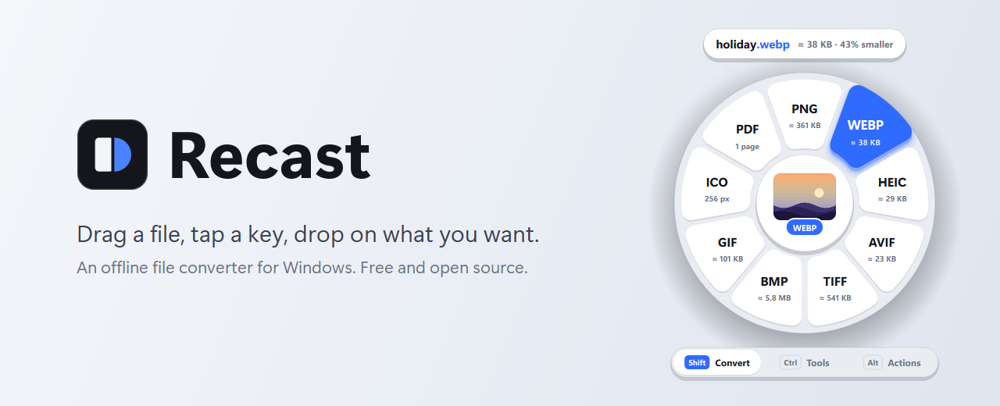
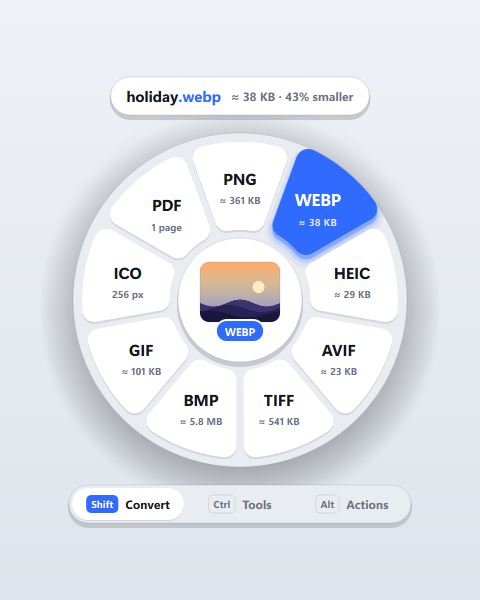
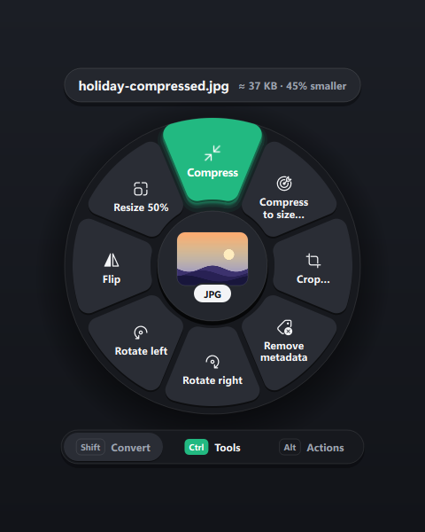

<p align="center">
  
</p>

# Recast

An offline file converter for Windows. Start dragging a file, tap a key, and a wheel opens under your pointer: drop on what you want. Nothing is uploaded; everything runs on your PC.

> **Inspired by Tangerine.** Recast is heavily inspired by [Tangerine](https://tangerineformac.com/), the drag-and-tap file converter for Mac, and exists because there was nothing like it on Windows. It's an independent, unofficial project written from scratch: it shares no code or assets with Tangerine and isn't affiliated with or endorsed by its makers. If you're on a Mac, go get Tangerine.

## Install

1. Download `Recast-Setup-x.y.z.exe` from [Releases](../../releases).
2. Run it. It installs for your user only, with no admin prompt.
3. For audio and video, the installer offers to add [FFmpeg](https://ffmpeg.org/) through winget.

Recast then sits in the tray. Windows 10 and 11, 64-bit.

## How it works

| Tap while dragging | Wheel | Examples |
| --- | --- | --- |
| **Shift** | Convert | JPG → PNG / WEBP / HEIC / AVIF, MOV → MP4, PDF → PNG, CSV → XLSX |
| **Ctrl** | Tools | Compress, crop, trim, compress to a size, For Discord, rotate, merge PDFs |
| **Alt** | Actions | Copy, copy path, move to…, open a terminal here, ZIP |

<p align="center">
  
  
</p>

- **You see the result before you drop.** Each tile shows roughly what you'll get ("WEBP ≈ 38 KB").
- **Nothing is overwritten.** Results are saved next to the original, and Undo sends a result to the Recycle Bin.
- **Drop in the middle to repeat** your last pick for that kind of file.
- **Pin favourites** by tapping the wheel's key again over a tile.
- **No drag needed:** copy a file or image and press Ctrl+Alt+R, or use right-click → Send to → Recast.

More in the [user guide](docs/USAGE.md): every tool, Clip Inbox for game clips, HDR screenshots, settings and supported formats.

## Light on your PC

Recast idles at about 30 MB and starts in under a second. Heavy work (PDFs, HDR images, the video trimmer) runs in a short-lived helper process, so the memory goes back to Windows when it's done.

## Build from source

Needs Python 3.12 or newer.

```
git clone https://github.com/kevinbonomi2-bit/recast
cd recast
"Start Recast.bat"
```

See [BUILDING.md](docs/BUILDING.md) for tests, the packaged app and the installer.

## License

[AGPL-3.0](LICENSE). Recast bundles PyMuPDF (AGPL) and other open-source libraries; see [THIRD-PARTY.md](THIRD-PARTY.md).
